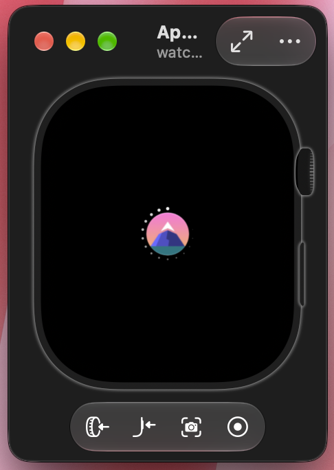
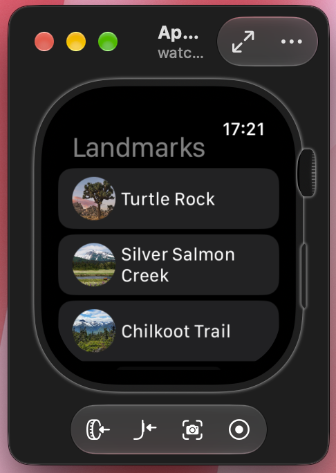
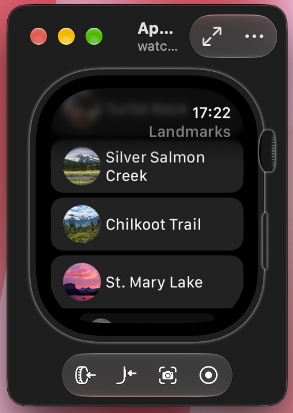
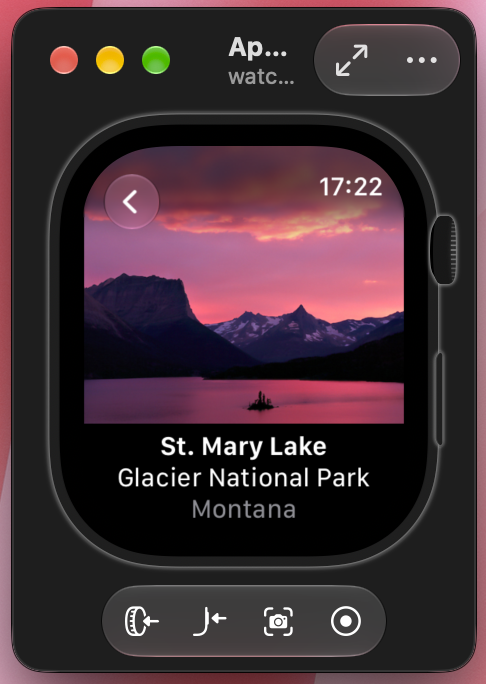
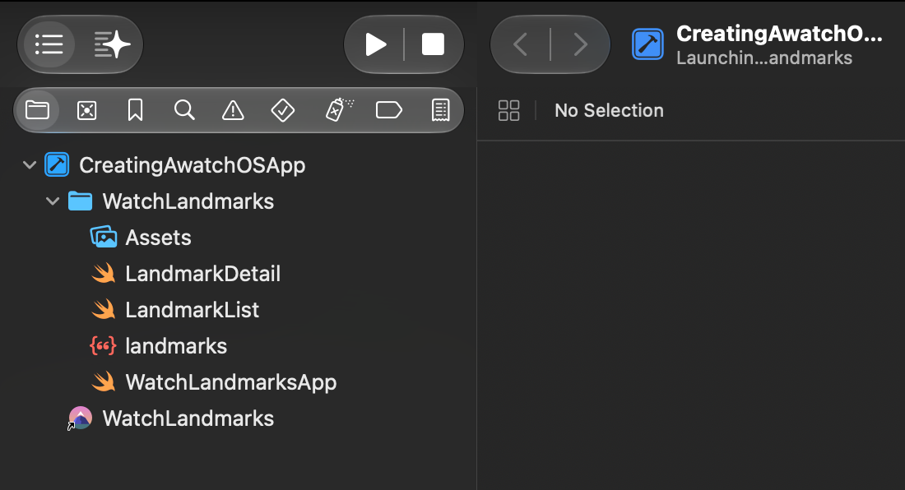
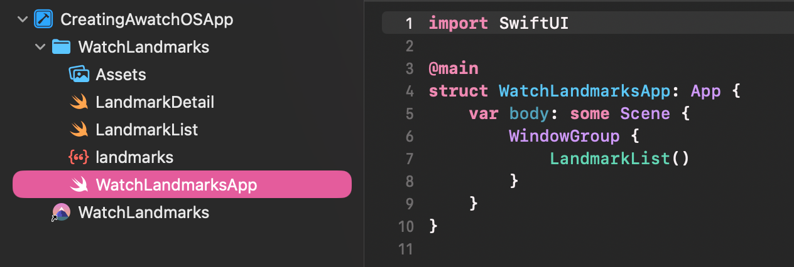
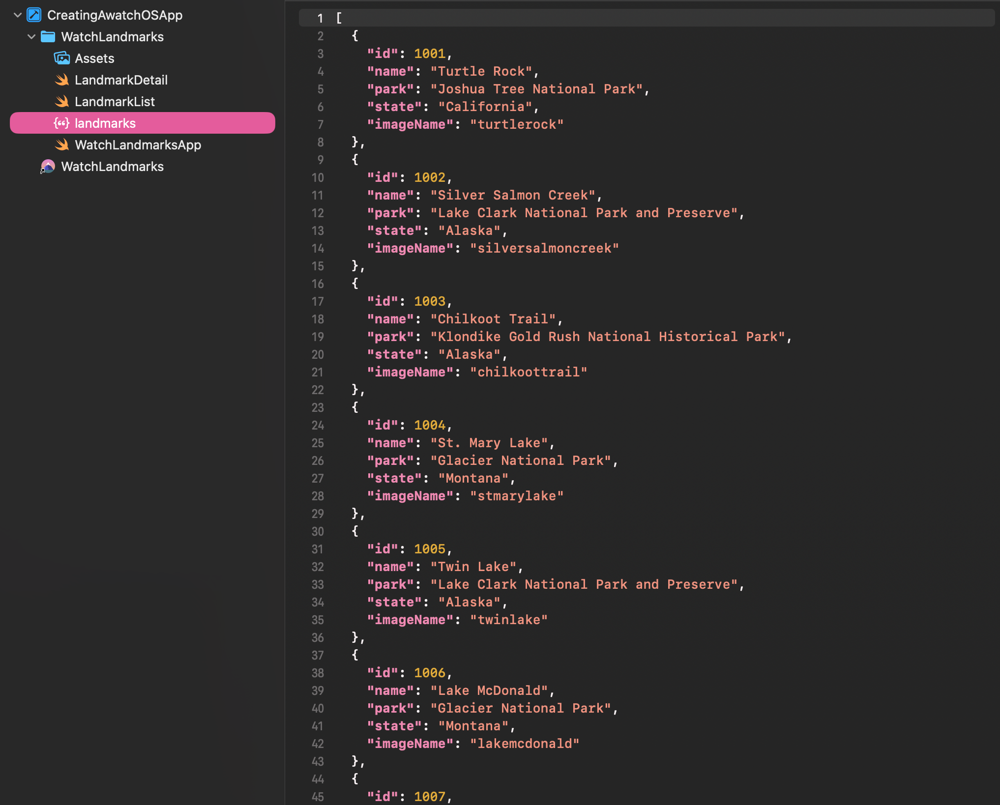
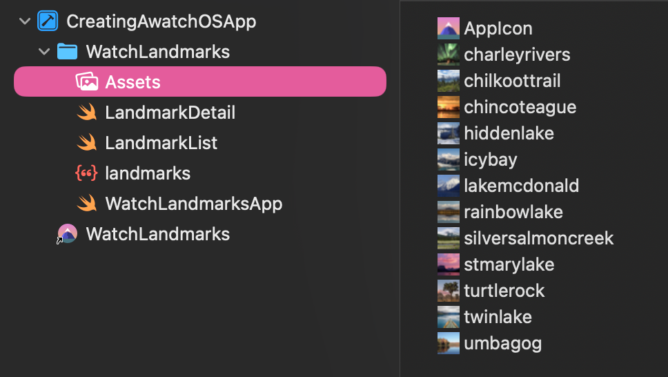
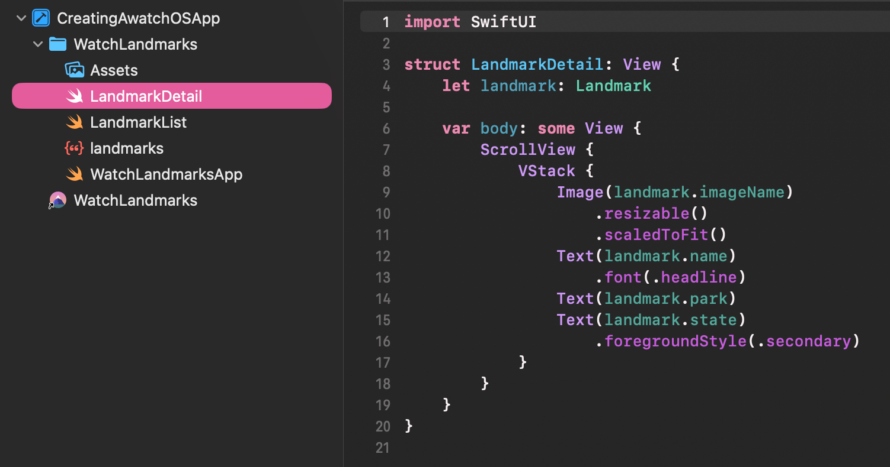

# My first run of WatchLandmarks

I opened `CreatingAwatchOSApp` in Xcode. That is the project name. The app I ran is called **WatchLandmarks**, and its
first screen is titled **Landmarks**. It lets me browse places on an Apple Watch and tap one to see a larger photo, the
park and the state.

## What I saw in the simulator

I ran the app from Xcode and saw the mountain icon while it loaded. The first screen showed Turtle Rock, Silver Salmon
Creek and Chilkoot Trail. Each row had a name and a small round photo.

| Opening the app                                               | The first landmarks                                         |
|---------------------------------------------------------------|-------------------------------------------------------------|
|  |  |

I scrolled down until **St. Mary Lake** came into view. Scrolling moved me further down the same list. Tapping the row
opened a second screen with a larger photo of the lake and the location underneath: **Glacier National Park, Montana**.
The back arrow at the top takes me back to the list.

| After scrolling                                                        | After tapping St. Mary Lake                                                        |
|------------------------------------------------------------------------|------------------------------------------------------------------------------------|
|  |  |

## How I read the Xcode project

I recognised the two screens in the file names. The app is written in Swift and uses SwiftUI to describe what appears on
the watch.

I traced the launch of the app through these lines in `WatchLandmarksApp.swift`.

| Line                                              | What I learnt                                                                                                                                                                                      |
|---------------------------------------------------|----------------------------------------------------------------------------------------------------------------------------------------------------------------------------------------------------|
| 1 · `import SwiftUI`                              | This makes the SwiftUI types used in this file available, including `App` and `WindowGroup`.                                                                                                       |
| 3–4 · `@main` and `struct WatchLandmarksApp: App` | `@main` marks the entry point. My app is a Swift structure that conforms to the `App` protocol, so SwiftUI provides the startup code.                                                              |
| 5 · `var body: some Scene`                        | `body` is a computed property that describes the app’s scene. `some Scene` means it returns one concrete type that conforms to `Scene`. Here that type is a `WindowGroup` containing my list view. |
| 6–7 · `WindowGroup { LandmarkList() }`            | The braces describe the window’s content. `LandmarkList()` creates the root view, so the first app screen I see on the watch is the list.                                                          |

The rows themselves are defined in `LandmarkList.swift`. That is where I can follow how each place gets its photo and
name.

I found St. Mary Lake in `landmarks.json`. Its entry gives the park as Glacier National Park, the state as Montana and
the photo name as `stmarylake`.

I matched `stmarylake` in the JSON to the photo with the same name in `Assets`. Both screens use that photo.

I followed the St. Mary Lake record from the JSON file to the row I tapped on the watch.

| Lines     | What I learnt                                                                                                                                                                                                                                                                     |
|-----------|-----------------------------------------------------------------------------------------------------------------------------------------------------------------------------------------------------------------------------------------------------------------------------------|
| 3–8       | `Landmark` describes one place. Its `let` properties hold its ID, name, park, state and image name. `Identifiable` lets SwiftUI track a row by its ID. `Decodable` lets the decoder match JSON keys to these properties.                                                          |
| 10–19     | `Landmark.examples` is an array shared by the type. The first time I access it, the closure `{ … }()` looks for `landmarks.json` in the app bundle. `Data(contentsOf:)` reads the bytes and `JSONDecoder` turns them into an array of landmarks. Later accesses reuse that array. |
| 11–17     | If the file is missing, `guard let` takes the first error path. If reading or decoding fails, `catch` takes the second. In both cases, `preconditionFailure` stops the app with a diagnostic message.                                                                             |
| 22–25, 39 | `LandmarkList` is a SwiftUI view. Its `body` places a scrollable `List` inside a `NavigationStack` and sets the title to **Landmarks**. In the row closure, `landmark` means the current place.                                                                                   |
| 28–35     | The link’s `label` is the row I see. `HStack` puts the photo beside the name. The image scales to fill a 40 × 40 point frame and is clipped to a circle.                                                                                                                          |
| 26–27     | When I tap St. Mary Lake, `NavigationLink` opens `LandmarkDetail(landmark: landmark)`. The first `landmark` names the input to the detail view. The second is the value from the row I tapped.                                                                                    |

I matched the code in `LandmarkDetail.swift` to what I saw after tapping St. Mary Lake.

| Lines | What I learnt                                                                                                                                                                                                   |
|-------|-----------------------------------------------------------------------------------------------------------------------------------------------------------------------------------------------------------------|
| 3–4   | `LandmarkDetail` is a SwiftUI view. Its `let landmark: Landmark` property holds the place passed in by the row I tapped. The same view can display any place in the list.                                       |
| 6–8   | `body` describes the screen. `VStack` arranges the photo and text from top to bottom. The surrounding `ScrollView` lets me scroll vertically if the content extends beyond the watch screen.                    |
| 9–11  | For St. Mary Lake, `Image(landmark.imageName)` selects the `stmarylake` photo from Assets. With `.resizable()` and `.scaledToFit()`, the whole photo fits the available space and keeps its proportions.        |
| 12–16 | I see **St. Mary Lake** in the headline style, then **Glacier National Park** underneath. The final modifier, `.foregroundStyle(.secondary)`, applies only to the state, so **Montana** appears less prominent. |

## Resources

Apple’s [Creating a watchOS app](https://developer.apple.com/tutorials/swiftui/creating-a-watchos-app) is the Landmarks
tutorial we
adapted. [Download Apple’s original project (ZIP)](https://developer.apple.com/tutorials/downloads/com.apple.SwiftUI/CreatingAwatchOSApp.zip).

To follow the screenshots in this
walkthrough, [download our simplified WatchLandmarks demo (ZIP)](https://github.com/ms-Maryna/WearableAppDev/raw/refs/heads/main/samples/CreatingAwatchOSApp.zip).
Unzip it, open `Complete/CreatingAwatchOSApp.xcodeproj` in Xcode, select an Apple Watch simulator and press **⌘R**.

| Part of our demo                                                    | Apple documentation                                                                                                                                    |
|---------------------------------------------------------------------|--------------------------------------------------------------------------------------------------------------------------------------------------------|
| Choose a simulator in Xcode and run the watch app                   | [Running your app on simulated or physical devices](https://developer.apple.com/documentation/xcode/running-your-app-on-simulated-or-physical-devices) |
| Understand why `@main` marks `WatchLandmarksApp` as the entry point | [App](https://developer.apple.com/documentation/swiftui/app)                                                                                           |
| Decode the records in `landmarks.json` into an array of landmarks   | [JSONDecoder](https://developer.apple.com/documentation/foundation/jsondecoder)                                                                        |
| Show one row per landmark in a scrollable list                      | [List](https://developer.apple.com/documentation/swiftui/list)                                                                                         |
| Open the detail view when we tap St. Mary Lake                      | [NavigationLink](https://developer.apple.com/documentation/swiftui/navigationlink)                                                                     |
| Display the photo named by `imageName` from the asset catalogue     | [Image](https://developer.apple.com/documentation/swiftui/image)                                                                                       |
